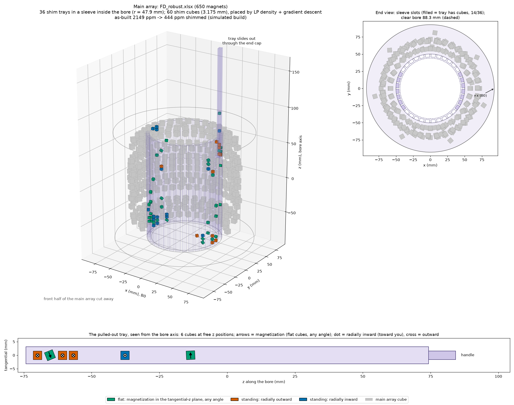
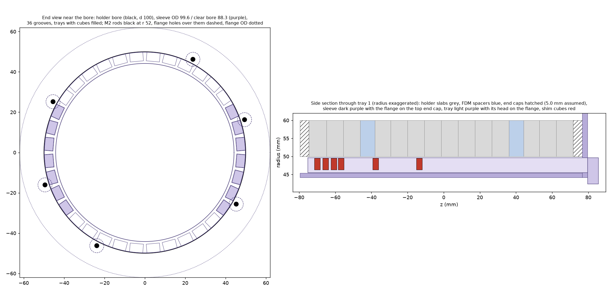
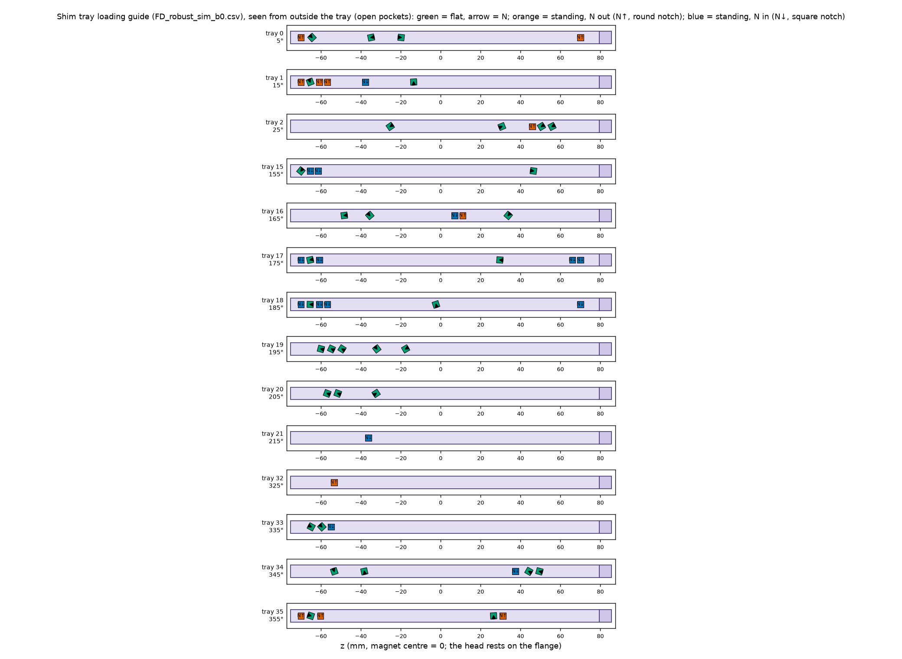

# Passive shimming: slide-in shim sleeve

How to shim the as-built magnet, without taking it apart, with a printed sleeve of shim trays inside the bore. Small
cubes (1/8", N42) are placed by the same field-driven pipeline as the main array (FIELD_DESIGN.md): continuous source
density by LP, discrete magnets from the density, then gradient refinement of every cube's position and angle.

Tools: `shim_design.py` (placement), `make_shim_cad.py` (sleeve, trays, loading guide), `plot_shims.py` (picture).
Design: `results/field_design/FD_robust.xlsx` (650 cubes, robust design; holder CAD from `make_ring_cad.py`).



## Why shim

With ideal magnets FD_robust gives 639 ppm over the 40 x 40 mm cylinder; with typical magnet errors (Br 0.8%, angle
0.7 deg, position +-0.25 mm) it is 2,400 ppm typical, 3,200 ppm p90. The errors are random, so the as-built field is not
known until it is measured, and no design change removes them. Shimming after the build does.

What an ideal shim of a given order would leave (`magsimulator.tolerance_homogeneity`, 400 builds, typical / p90 ppm):

| Shim removes | FD_robust | Previous BEST |
|---|---|---|
| nothing (mean only) | 2,461 / 3,277 | 3,217 / 4,123 |
| + linear terms (gradient offsets) | 1,588 / 2,204 | 2,297 / 3,016 |
| + second-order terms | 1,104 / 1,339 | 1,580 / 1,997 |

The sleeve below does better than a perfect second-order shim (440-630 ppm on simulated builds), because it also corrects higher orders.

## What MRI4ALL did

[mri4all/passive_shimming](https://github.com/mri4all/passive_shimming) (ISMRM 2024 #4085), the same magsimulator /
ledger / magcadexporter code as this repo:

- 3 mm cubes (Br 1270 mT) on two sleeves inside the bore at r = 66.5 mm, one at each end (z = +-70 to +-152 mm):
  2 x 28 rings x 10 slots, 3 mm apart.
- Per slot: empty or a cube; the cube's rotation (0/90/180/270 deg from radial) is chosen per angle and shared by every
  ring.
- Genetic algorithm (pymoo MixedVariableGA, 100 x 3000 generations) on the standard deviation of a measured map
  (11 x 11 x 11 grid over a 100 mm cube, 1,333 points, from their field mapper).
- Their saved solution: 259 cubes. Re-evaluated on their map: standard deviation 1,378 -> 700 ppm, peak-to-peak
  12,191 -> 8,062 ppm at 42.8 mT. The sleeve itself is not in the repo (the CAD export only places 3 mm cube models).

## Options considered

All on FD_robust, simulated builds (as above), peak-to-peak over the 40 x 40 mm cylinder (1,990 check points):

| Option | Result (3 builds, unshimmed 2,149 / 3,461 / 2,246) | Shim magnets | Notes |
|---|---|---|---|
| Pockets inside the holder slices | - | - | needs the stack taken apart: rejected |
| Trays in the holder rim, r = 90 mm, fixed pockets, 1/4" cubes | 896 / 822 / 985 | 60 | MILP on a pocket grid; OD 178 -> ~195 mm |
| Bore sleeve, fixed pockets, 1/4" cubes | 8,700-14,500 | 80-90 | cubes too coarse this close to the target |
| Bore sleeve, fixed pockets, 1/8" cubes | ~990 (one build) | 14 | the LP says 23-66 ppm is possible; rounding to a pocket grid loses it |
| **Bore sleeve, LP density + gradient, 1/8" cubes** | see Results | <= 60 | **chosen** |

Inside the bore wins because the cubes are 2x closer to the target (r 48 vs 90 mm): far less magnet for the same
correction (60 small cubes = 7.5 big ones), and the higher-order terms are reachable. The price is bore: 88.3 mm clear
instead of 100.

## Method (`shim_design.py`)

1. **Field map.** A measured map (`--map`: csv x, y, z, Bx in mm and mT, or the MRI4ALL `.mat` pair), or simulated
   as-built builds of the ledger (`--simulate N`) to study the design before building.
2. **LP density.** Points every a/2 along each of the 36 trays, 6 directions each (+-radial, +-tangential, +-z):
   minimize the peak-to-peak deviation (minimax LP, HiGHS) with B0 >= `--min-b0` (44.8 mT) and at most `--max-cubes`
   (60) cubes. This is the continuous optimum: 65-72 ppm.
3. **Placement.** Walk each tray; a cube goes wherever the accumulated |density| passes k + offset and points along the
   local density: flat (magnetization in the tangential-z plane, at the matching angle) or standing (radially in or
   out) when the density is mostly radial. Cubes beyond the cap with the least density around them are dropped. Three
   offsets are tried.
4. **Gradient refinement.** SLSQP minimax over every cube's z and every flat cube's angle, with tray spacing (the full
   diagonal for flat cubes, which may turn to any angle, plus 0.8 mm), |z| <= 70 mm and B0. The cubes are 25+ mm from
   the check points, so a point dipole is exact enough and the gradients are analytic; the result is checked with the
   exact cuboid field.
5. **Shim-cube errors.** The shim cubes have the same Br (0.8%) and angle (0.7 deg) errors as the main cubes; these
   are propagated linearly and reported (typical and p90 after shimming).

Why not a fixed pocket grid: the trays are printed for each solution, so pockets can be anywhere and at any angle. On a
grid the continuous optimum (~65 ppm) rounds to ~1,000 ppm at best; letting positions and angles move recovers most
of it.

## Results

`results/shim/FD_robust_sim.log` (`shim_design.py --simulate 3`, defaults: 36 trays, at most 60 cubes, B0 >= 44.8 mT),
peak-to-peak over the 40 x 40 mm cylinder, exact cuboid fields, 1,990 check points:

| Build | Unshimmed | LP bound | Shimmed | Cubes (flat / out / in), trays | B0 after | With shim-cube errors, typical / p90 | Time |
|---|---|---|---|---|---|---|---|
| 0 | 2,149 | 72 | **444** | 60 (34 / 11 / 15), 14 | 44.88 mT | 642 / 775 | 76 s |
| 1 | 3,461 | 73 | **459** | 60 (42 / 8 / 10), 14 | 44.97 mT | 641 / 759 | 135 s |
| 2 | 2,246 | 72 | **632** | 60 (35 / 11 / 14), 16 | 44.91 mT | 764 / 867 | 97 s |

For comparison, a perfect second-order shim leaves 927-1,141 ppm on the same builds. The CAD and figures on this page
are for build 0.

The shim-cube errors are the limit now: at 48 mm from the target a 1/8" cube's 0.7 deg angle error is worth more than
the remaining design residual. Plan on two rounds: map, shim, re-map, then re-run `shim_design.py` on the new map and
reprint the few trays that change.

## Hardware (`make_shim_cad.py`)



| Part | Dimensions (defaults) | Notes |
|---|---|---|
| Sleeve | OD 99.6 (0.2 mm radial fit in the 100 mm bore), clear bore 88.3, 36 grooves 6.59 wide x 4.42 deep, ribs 1.33 mm at the groove bottom; z -79.6 to +76.6 plus a 3 mm flange | One part (SLA, ~159 mm tall, prints standing on the flange). The grooves are open on the outside: the holder's bore wall closes them, so they are the tray channels. |
| Flange | OD 124, 3 mm, on the outer face of the top end cap | Sets the sleeve's z (and with its +x notch, its rotation). Six 7 mm holes clear the M2 rods and nuts of the holder (r = 52 mm). |
| Trays | 6.29 wide x 4.17 thick, z -75.2 to +79.6, head 6 mm above the flange | One per groove that holds cubes (14 in the example). Pockets open on the outer face, cube on a 0.8 mm floor (cube centres at r = 47.91 mm, as in the optimization), 1.2 mm push-out hole under each. The head rests on the flange: it sets the tray's z. Tray number engraved on the head. |

Pocket marks: flat cubes have a V notch at the N face (pocket turned to the cube's angle); standing cubes have a round
notch if N faces out (towards the holder) and a square notch if N faces in (towards the bore axis).
`tray_loading.png` shows every tray as seen from the open pocket side; `trays.csv` lists each cube's tray, z (also as
distance from the flange top) and orientation.



**Fit with the holder.** Nothing in the holder changes. The sleeve passes through both end caps, so the end caps (your
design, see CAD.md) need a 100 mm bore like the rings, a flat outer face on the top cap for the flange, and M2 nuts no
taller than the flange (3 mm) inside the 7 mm holes. The script assumes 5 mm end caps (`--endcap`); with other end caps
regenerate the sleeve and trays with the right value so the cubes stay at the z they were optimized for. All parts
share the holder's coordinates (`shim_assembly.step` overlays `assembly.step`).

**Forces.** The main array's field at the shim radius is 47 mT median, 104 mT maximum: at most 3.5 N mm of torque on a
shim cube (the pocket holds it), and at most 83 kA/m against a reversed cube, far below N42's coercivity.

## Workflow

```bash
# holder for the design (bolt holes go to holes.csv; the sleeve flange clears the inner rods)
python make_ring_cad.py results/field_design/FD_robust.xlsx --out cad/fd_robust --magnets

# after building: map the field (e.g. MRI4ALL field_mapper_3DFM) over the target region, then
python shim_design.py results/field_design/FD_robust.xlsx results/shim/round1 --map map.csv
python make_shim_cad.py results/shim/round1_map.csv --holder cad/fd_robust --out cad/shim_round1
python plot_shims.py results/field_design/FD_robust.xlsx results/shim/round1_map.npz figures/shim_round1.png

# before building, what shimming buys on simulated builds
python shim_design.py results/field_design/FD_robust.xlsx results/shim/FD_robust_sim --simulate 3
```

Print the sleeve and trays in the same resin as the rings (Rigid 4000); check the tray-in-groove slide and the 1/8"
pocket fit with a short test piece first (clearances `--slide`, `--pocket-tol`). Load each tray from `tray_loading.png`
(identify N with a compass or a marked reference cube), slide it in until the head sits on the flange, re-map.

## Limits and next steps

- The map is the input: its accuracy and extent set what the shim can fix. Map at least the target cylinder's surface
  (the field is harmonic, so the surface bounds the inside); the simulated runs use 1,990 points on it.
- Shim-cube errors (above) and magnet-magnet interaction (finite permeability, OSII_COMPARISON.md) are not in the
  placement; a second round on a fresh map takes care of both.
- Placement with few cubes (cap 30) is unreliable: some starts end at thousands of ppm. The three starts usually find a
  good one at the default cap of 60.
- Not yet done: a tray/groove fit coupon, temperature (shims have the same temperature coefficient as the main array, so
  homogeneity is first-order unaffected), and the end caps themselves.
