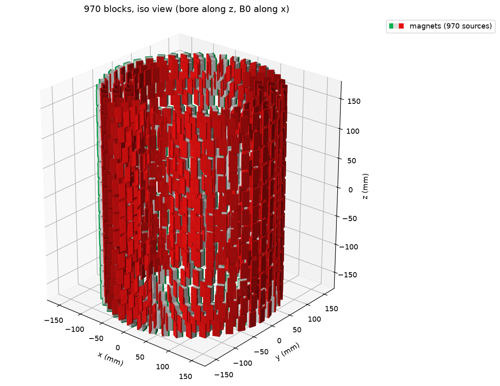
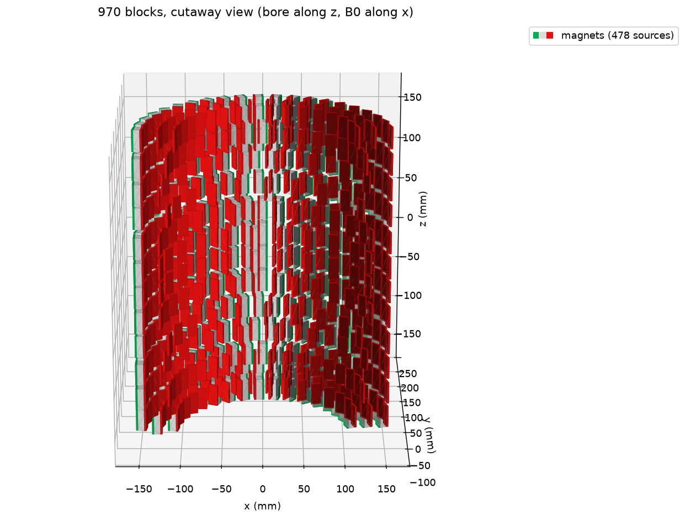
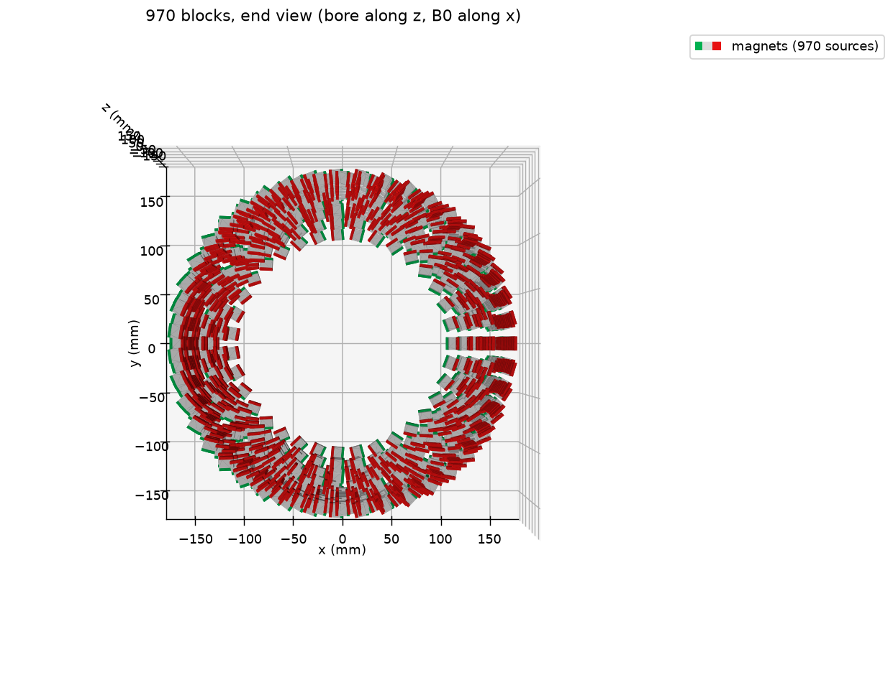
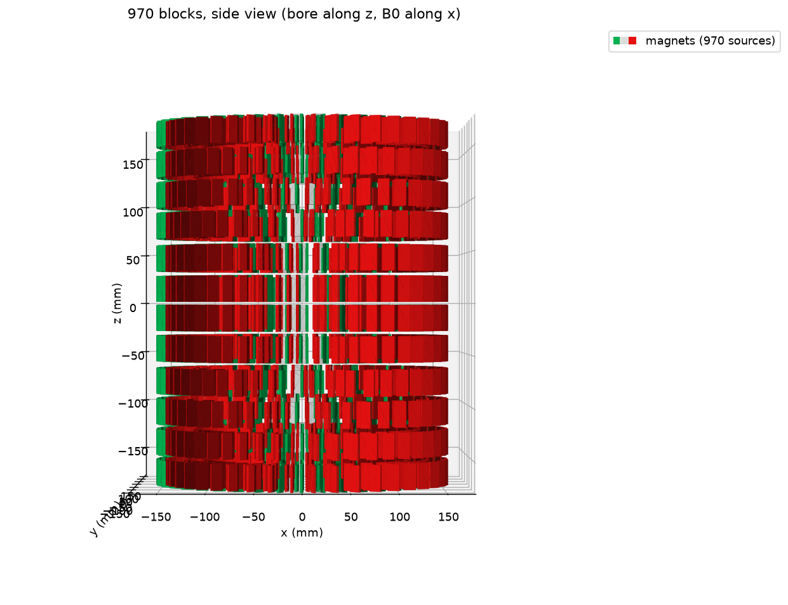

# 12cm_bore200: 200 mm bore, ~50 ppm, 96.0 mT

| | |
|---|---|
| B0 | **96.01 mT** (Br = 1.30 T; scales linearly with Br) |
| Homogeneity | 50.07 ppm peak-to-peak of Bx over the 120 mm sphere (50,000 surface points; 50.0 on 20,000), ideal magnets |
| Magnets | **970** x KJ BX088SH (N42SH, 25.4 x 12.7 x 12.7 mm) |
| Magnet mass | 29.8 kg (30.73 g each) |
| Bore ID (plastic) | **201.1 mm** (closest block corner at r = 102.54 mm, 2 mm wall) |
| OD (plastic) | **325.0 mm** (outermost block corner at r = 160.50 mm, 2 mm wall) |
| Magnet length | **357.8 mm** end to end (limit 360) |
| Min gaps | 1.87 mm within a ring, 2.17 mm between rings of a slice, 3.00 mm between slices; no overlaps ([gap_check.txt](gap_check.txt)) |

Orientation: each block's 25.4 mm side along the bore (z), magnetized through a 12.7 mm face, in the ring plane at
angle 2*theta for a block at azimuth theta; B0 along x.

## Layout (6 slice pairs at +-z; rings: n blocks @ radius of block centers, mm)

| Slice z | Inner | Middle | Outer |
|---|---|---|---|
| +-14.2 | | 23 @ 131.52 | 48 @ 151.52 |
| +-44.2 | | 31 @ 131.52 | 48 @ 151.52 |
| +-76.2 | | 21 @ 121.52 | 47 @ 151.52 |
| +-106.2 | | 18 @ 131.52 | 46 @ 151.52 |
| +-136.2 | | 39 @ 121.52 | 48 @ 151.52 |
| +-166.2 | 35 @ 111.52 | 38 @ 131.52 | 43 @ 151.52 |

Every block: [placements.csv](placements.csv) (x, y, z of the block center in mm; rot_z_deg = magnetization angle from
+x). Specs as JSON: [design.json](design.json). Optimizer output: [run.log](run.log).

## Settings that produced it

```bash
python field_design_12cm.py results/12cm/m1_dr5_dz2.xlsx --bore 200 --bore-wall 2 --od-wall 2 --ppm 50 --margin 1 \
    --dr-grid 5 --dz 2 --milp-time 150 --time-limit 360
```

Gurobi 13.0.3 (academic license), MILP proven optimal for this grid (gap 0.00%) in 57 s on 12 cores. Defaults
otherwise: 1200 sphere points (quarter used), ripple 2e-6, slice wall 3 mm, layer wall 2 mm, ring wall 1.5 mm, max OD
325 mm, max length 360 mm, Br 1300 mT.

## Notes

- B0 vs ppm is a staircase, not a slope: on this grid the optimum is ~60 mT up to ~42 ppm and jumps to ~88-96 mT from
  ~46 ppm, because above that point the inner ring layer can be mostly filled. Small changes to the ppm target near
  the step change B0 a lot.
- Ideal magnets only. As built, magnet errors put real builds at thousands of ppm before shimming.

## 3D views

Made with `python utilities/plot_design_3d.py designs/12cm_bore200/placements.csv` (magpylib Collection + `magpy.show`, as in
MRI4ALL's `magsimulator.plot_magnets3D`, with the true block size). Red = north side of each block.

| Isometric | Cutaway (y > 0 half) |
|---|---|
|  |  |
| **End (along the bore)** | **Side** |
|  |  |

## Forces on the holders and assembly

From `utilities/forces_12cm.py` (`forces.txt`, per-block `forces.csv`), `utilities/assembly_12cm.py` (`assembly.txt`)
and `utilities/insertion_12cm.py` (`insertion.txt`). Br 1.3 T, ideal blocks.

**Finished magnet**
- The two halves **push apart with 1,752 N (179 kgf)**: every slice is pushed away from the midplane. Clamp the stack
  with non-magnetic (316 / brass) tie rods through stiff end plates; nuts should bear on metal, not resin.
- Per block: max force 38.7 N (radial 33, tangential 37, axial 25 N), max torque 1.08 N m about z. Spread over the
  pocket walls these are ~0.1-0.8 MPa, ~2.6 MPa on the thinnest (1.87 mm) web: a few % of Tough 2000's strength, so
  creep (use Rigid 4000/10K) rather than strength is the concern.
- Per plate, pushing on the pocket face toward the midplane: at most 211 N in total (plates at z = +-136.2), max
  10.6 N on one block; the plates at +-14.2 have none. Toward the outward face: up to 720 N (end plates).

**Stacking plate by plate** (each plate pushed away the whole way in; peak at contact)
- One end to the other: 54-63 kgf per plate typically, 151 kgf for the plate that seats onto the other half.
- Two halves built separately: up to 82 kgf per plate, then 179 kgf to join them.
- Individual blocks see up to 35 N axially, in both directions: 491 of 970 blocks are pushed back toward the built
  plates at some point, 838 forward.

**All plates on long rods, closed together** (frictionless sliding plates)

| Extra spread E | Rod length | Force to start closing |
|---|---|---|
| 1000 mm | 1418 mm | 1.8 kgf |
| 600 mm | 1018 mm | 5.3 kgf |
| 400 mm | 818 mm | 10.5 kgf |
| 0 (closed) | - | 179 kgf total, 292 N per rod (6 rods) |

1 m rods are enough. Block loads never exceed the finished-magnet values (25 N outward, 10.6 N toward the
midplane). Friction on the rods makes closing uneven and pushes block loads toward the plate-by-plate numbers.
Swap the long rods for final-length ones one at a time instead of cutting them next to the magnet.

**Filling a plate** (floor on the outward face, open toward the midplane)
- Seated blocks are pulled toward the open face by up to 13.5 N while a neighbour is half inserted (12.7 mm).
- The block being inserted resists by up to 11 N partway in, then is pulled in by up to 31 N.
- Retention: a floor on the outward face plus a bolted cover on the midplane face (non-magnetic screws). Cover plus
  the next plate's floor must fit in the 3.0 mm (midplane) / 4.6 / 6.6 mm gaps between slices. Use a light friction fit
  (>= ~15-20 N) or a temporary hold-down plate while filling. In the closed stack each open face sits against the
  next plate's floor.
