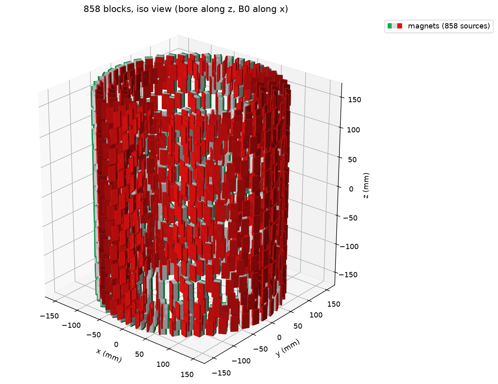
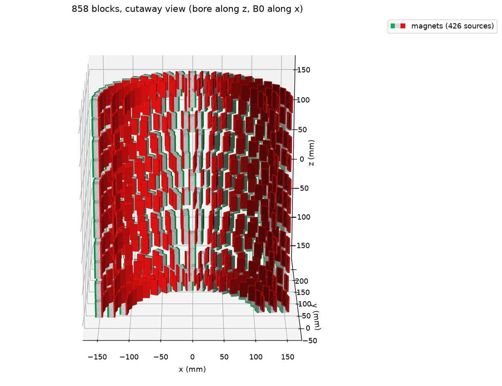
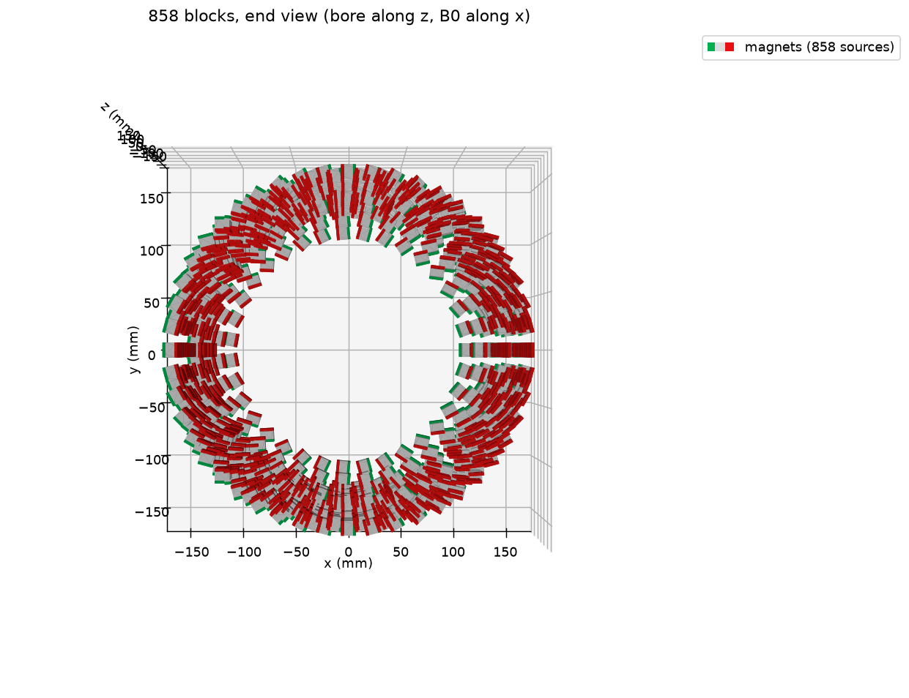
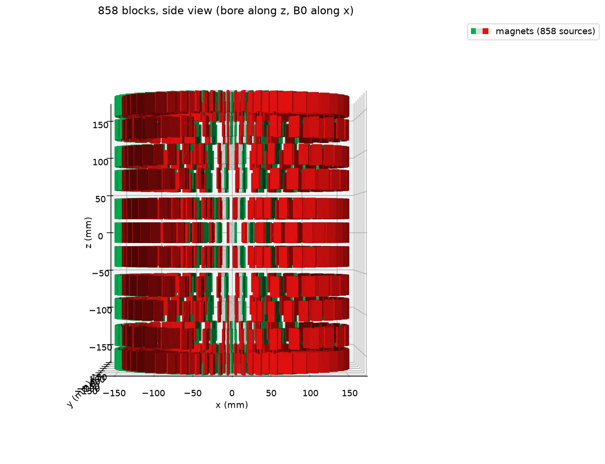

# 12cm_bore200_84mT: shortest 84 mT design, 200 mm bore, 50 ppm

Same envelope as [12cm_bore200](../12cm_bore200/README.md) (200 mm bore, 325 mm OD, 50 ppm) but asking for 84 mT and
the shortest magnet length instead of the most field.

| | |
|---|---|
| B0 | **84.90 mT** (Br = 1.30 T; scales linearly with Br) |
| Homogeneity | 48.6 ppm peak-to-peak of Bx over the 120 mm sphere (50,000 surface points), ideal magnets |
| Magnets | **858** x KJ BX088SH (N42SH, 25.4 x 12.7 x 12.7 mm) |
| Magnet mass | 26.4 kg |
| Bore ID (plastic) | **201.1 mm** (2 mm wall) |
| OD (plastic) | **325.0 mm** (2 mm wall) |
| Magnet length | **345.8 mm** end to end (12.0 mm shorter than the 96 mT design) |
| Min gaps | 2.02 mm within a ring, 2.22 mm between rings of a slice, 4.60 mm between slices; no overlaps ([gap_check.txt](gap_check.txt)) |

## How short can an 84 mT design be?

Best B0 at 50 ppm vs the allowed magnet length (Gurobi, 5 x 2 mm grid; bound = Gurobi's proven upper limit):

| Max length | Best found | Upper bound | |
|---|---|---|---|
| 330 mm | 52.6 mT | ~78 mT | 84 mT impossible |
| 340 mm | 70.6 mT | ~83 mT | 84 mT impossible |
| **346 mm** | **84.9 mT** | 85.9 mT | **this design** |
| 360 mm | 96.0 mT | 96.0 mT | [12cm_bore200](../12cm_bore200/README.md) |

So the shortest 84 mT design lies between ~340 and 346 mm. Length comes in slice steps: each slice pair needs at
least 25.4 mm + 3 mm wall, and six pairs (plus a center slice) need ~338 mm at the tightest spacing.

## Layout (rings: n blocks @ radius of block centers, mm)

| Slice z | Inner | Middle | Outer |
|---|---|---|---|
| 0 (center) | | 20 @ 131.5 | 44 @ 151.5 |
| +-30.2 | | 25 @ 131.5 | 46 @ 151.5 |
| +-66.2 | | 34 @ 131.5 | 38 @ 151.5 |
| +-96.2 | | 20 @ 131.5 | 42 @ 151.5 |
| +-130.2 | | 35 @ 131.5 | 32 @ 151.5 |
| +-160.2 | 35 @ 111.5 | 42 @ 131.5 | 48 @ 151.5 |

Every block: [placements.csv](placements.csv) (x, y, z of the block center in mm; rot_z_deg = magnetization angle from
+x). Specs: [design.json](design.json). Optimizer output: [run.log](run.log).

## Settings that produced it

```bash
python field_design_12cm.py results/12cm/L346.xlsx --bore 200 --bore-wall 2 --od-wall 2 --ppm 50 --margin 1 \
    --max-length 346 --ripple 5e-7 --dr-grid 5 --dz 2 --milp-time 150 --time-limit 300
```

`--ripple 5e-7` (stricter than the default 2e-6) keeps rings large enough that their azimuthal ripple does not push
the result over 50 ppm. Gurobi stopped at its time limit with a 1.15% gap (bound 85.9 mT). Asking instead for
exactly 84 mT with the fewest magnets (`--b0 84`) gave 84.2-84.5 mT with fewer magnets but 57 ppm, because the
smallest allowed rings add ripple the linear model misses.

## 3D views

`python utilities/plot_design_3d.py designs/12cm_bore200_84mT/placements.csv`. Red = north side of each block.

| Isometric | Cutaway (y > 0 half) |
|---|---|
|  |  |
| **End (along the bore)** | **Side** |
|  |  |

## As-built tolerance

`python utilities/tolerance_12cm.py designs/12cm_bore200_84mT/placements.csv [--pos-tol 0.1]`, 2000 random builds
per case, ppm over the 120 mm sphere surface (ideal 48.5). Full tables: `tolerance.txt` (+-0.05 mm),
`tolerance_pos0.1.txt` (+-0.1 mm).

| Errors (uniform within) | median ppm | p90 ppm |
|---|---|---|
| position +-0.05 mm | 251 | 329 |
| position +-0.1 mm | 482 | 637 |
| magnetization angle +-1 deg (with +-0.05 mm) | 1555 | 2099 |
| Br +-0.5% (with +-0.05 mm) | 564 | 766 |
| all: 0.05 mm, 1 deg, 0.5% | 1625 | 2192 |
| all: 0.05 mm, 3 deg, 1.5% | 4822 | 6525 |

Magnetization-angle error dominates; shimming is needed either way.
